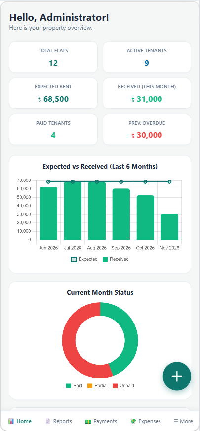
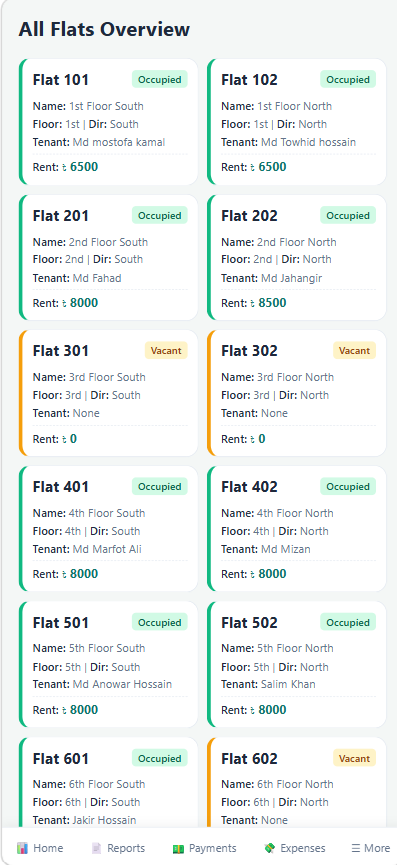
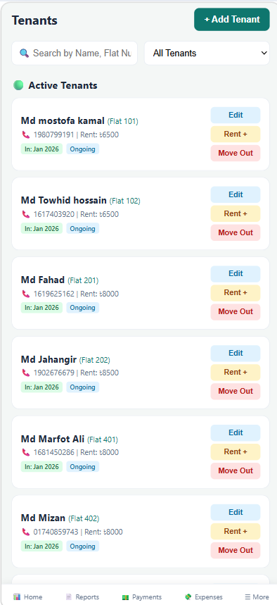
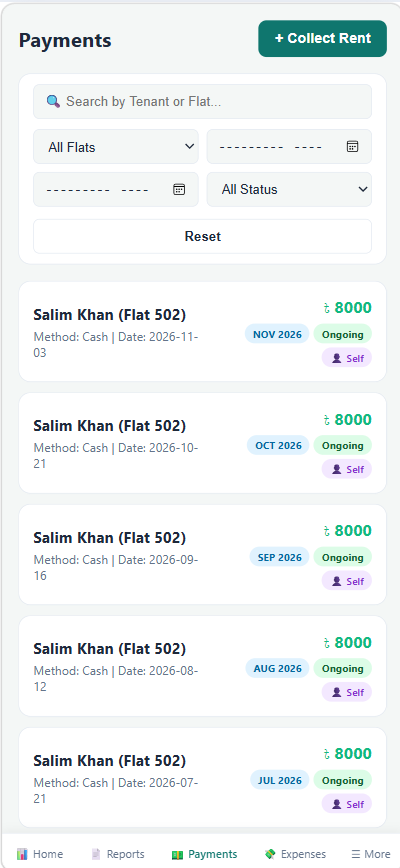
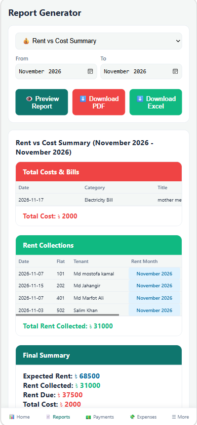
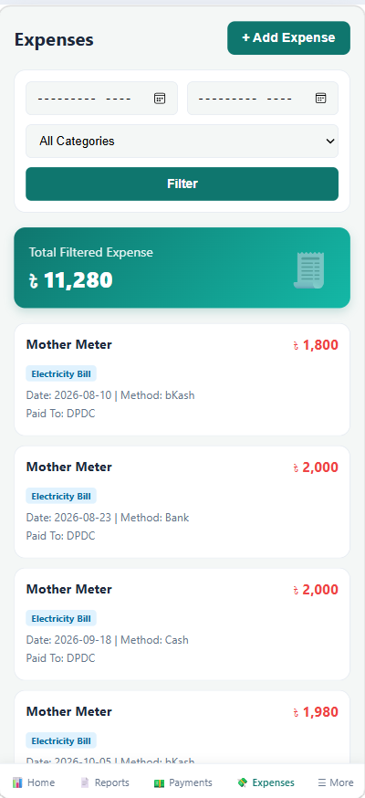

# 🏠 House Management System

A web-based house rental management app for landlords. Manage flats, tenants, rent collection, rent increases and expenses from one place, with a mobile-friendly dashboard and downloadable reports. Data is stored in Google Sheets, with Google Apps Script as the backend.

🔗 **Live Demo:** https://house-management-system-zeta.vercel.app/index.html

---
## ✨ Features

- **Dashboard**: overview of total flats, tenants, collected rent, due rent and expenses.
- **Flat management**: add and track flats and their status.
- **Tenant management**: tenant details, move-in date, rent and Tenant ID based records.
- **Rent collection**: record payments by month, with dues and advance calculated automatically.
- **Rent increase history**: past months keep their old rent, so calculations stay correct after an increase.
- **Expense tracking**: record and review house expenses.
- **Performance page**: collection performance at a glance.
- **Reports** with PDF and Excel export:
  - Tenant Detailed Report
  - Monthly Collection Report (tenant wise / month wise)
  - Flat History
  - Rent vs Cost Summary
- **Responsive UI**: two-column card layout, bottom navigation and a "More" bottom sheet on mobile.
- **Smooth loading**: skeleton loaders, page transitions and a top progress bar.
- **Login system** with session handling.

---

## 📸 Screenshots

| Dashboard | Flats |
|:---:|:---:|
|  |  |

| Tenants | Rent Payments |
|:---:|:---:|
|  |  |

| Reports | Expenses |
|:---:|:---:|
|  |  |

---

## ✨ Features

- **Dashboard**: overview of total flats, tenants, collected rent, due rent and expenses.
- **Flat management**: add and track flats and their status.
- **Tenant management**: tenant details, move-in date, rent and Tenant ID based records.
- **Rent collection**: record payments by month, with dues and advance calculated automatically.
- **Rent increase history**: past months keep their old rent, so calculations stay correct after an increase.
- **Expense tracking**: record and review house expenses.
- **Performance page**: collection performance at a glance.
- **Reports** with PDF and Excel export:
  - Tenant Detailed Report
  - Monthly Collection Report (tenant wise / month wise)
  - Flat History
  - Rent vs Cost Summary
- **Responsive UI**: two-column card layout, bottom navigation and a "More" bottom sheet on mobile.
- **Smooth loading**: skeleton loaders, page transitions and a top progress bar.
- **Login system** with session handling.

---

## 🛠️ Tech Stack

| Layer | Technology |
|---|---|
| Frontend | HTML, CSS, Vanilla JavaScript |
| Backend | Google Apps Script (`Code.gs`) |
| Database | Google Sheets |
| Charts | Chart.js |
| Export | jsPDF + jsPDF-AutoTable, SheetJS (XLSX) |
| Hosting | GitHub Pages |

---

## 🚀 Getting Started

### 1. Backend (Google Apps Script)
1. Create a Google Sheet with the sheets listed above.
2. Open **Extensions → Apps Script** and paste the contents of `Code.gs`.
3. Click **Deploy → New deployment → Web app**.
   - Execute as: **Me**
   - Who has access: **Anyone**
4. Copy the **Web app URL**.
